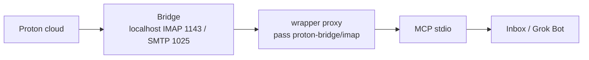
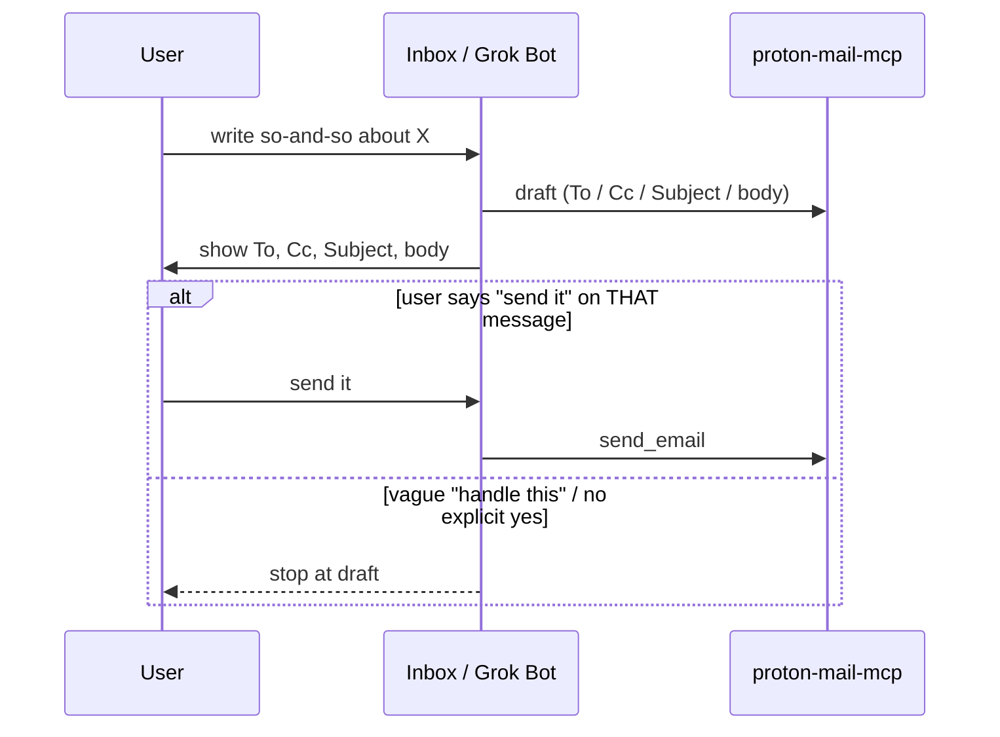
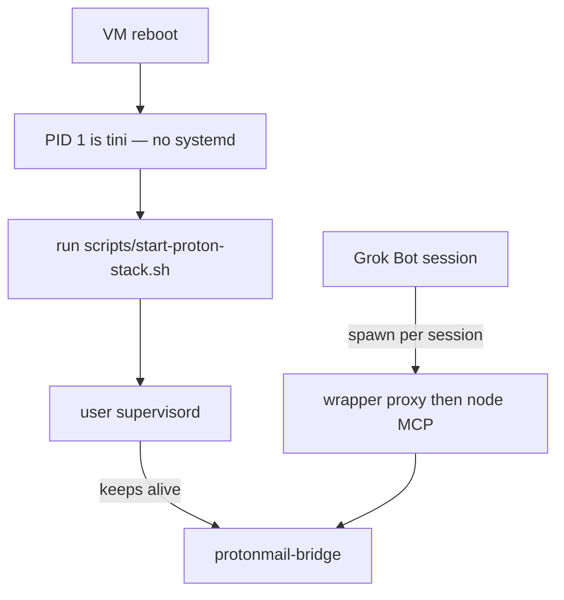

# Proton Mail MCP for Grok Bot

A public recovery base for talking to Proton Mail from Inbox / Grok Bot over
stdio. No secrets live here. Browser Proton burns quota; this is the cheap
local path: official Bridge on loopback, IMAP password in `pass`, MCP over
stdio.

Username comes from `PROTONMAIL_USERNAME`. Paths use `$HOME` (never a hardcoded
home directory). Replace `/home/YOU` in the supervisord example with your Unix
user.

The stdio wrapper is an NDJSON JSON-RPC **proxy** (not `execv`). It hides send
tools unless you opt in, and it can folder-gate mailbox access.

Windows, when Bridge is already installed on that PC, uses a different
process: `scripts/proton-mail-mcp-http.py` listens on `127.0.0.1` only,
authenticates with a separate bearer token, and speaks MCP Streamable HTTP
to the same patched Node server. See `docs/WINDOWS.md`. Tailscale is not
part of this setup; `docs/TAILSCALE-LATER.md` is the later step. Listing a
tool is not approval to call it.

macOS, when Bridge is already installed on that Mac, uses the same loopback
HTTP connector. The steps for Sean's Mac mini are below. Longer notes on
Keychain prompts and the Tailscale menu are in `docs/MACOS.md`.

## macOS (Apple Silicon)

Do these steps in order. Open **Terminal** from the Applications folder.
Use that window, not an SSH session. Each block is one paste. Press Return
after it. Wait until the shell asks for the next thing before you go on.

The connector listens only on `127.0.0.1:8765`. Tailscale Serve publishes
`https://seans-mac-mini.tail545f1e.ts.net/mcp` on the tailnet. Funnel stays
off. The Bridge password and the bearer token go in the login Keychain, not
in a file. Listing all 32 tools is not approval to send or delete mail.

1. Download the project.

```bash
mkdir -p "$HOME/Library/Application Support/ProtonMailMCP"
cd "$HOME/Library/Application Support/ProtonMailMCP"
curl -fsSL -o proton-mail-mcp.tar.gz "https://github.com/carney4289-collab/proton-mail-mcp-grokbot/archive/refs/heads/cursor/macos-launchagent-48a9.tar.gz"
tar -xzf proton-mail-mcp.tar.gz
rm -rf package
mv proton-mail-mcp-grokbot-cursor-macos-launchagent-48a9 package
rm proton-mail-mcp.tar.gz
```

2. Install Python, Node, and the mail connector. This does not use Homebrew
   and it does not ask for your Mac password. It asks for the Proton account
   email. That is not the password. The download can take a few minutes.

```bash
bash "$HOME/Library/Application Support/ProtonMailMCP/package/scripts/macos/install.sh"
```

3. Store the Bridge password. Bridge uses one password for both IMAP and
   SMTP. It is the password Bridge shows after you are signed in, not the
   Proton account password. Nothing you type is shown. If macOS asks whether
   Python may use the Keychain, click **Always Allow**. If it asks for your
   Mac login password, that only unlocks the login Keychain.

```bash
bash "$HOME/Library/Application Support/ProtonMailMCP/package/scripts/macos/store-bridge.sh"
```

4. Create the bearer token. It is stored in the Keychain and it is not
   shown. Click **Always Allow** if macOS asks again. If the script says the
   credential already exists, leave it. Do not delete it unless you intend
   to replace it in Keychain Access.

```bash
bash "$HOME/Library/Application Support/ProtonMailMCP/package/scripts/macos/new-http-auth.sh"
```

5. Leave Bridge's **Open at login** setting as it is. These scripts do not
   change it. Bridge should already be listening on `127.0.0.1:1143` and
   `127.0.0.1:1025`.

6. Install the login helper. It starts the connector after you sign in to
   the Mac, waits for Bridge, and restarts the connector if it crashes. It
   does not use sudo. The Mac has to stay awake, online, and signed in.

```bash
bash "$HOME/Library/Application Support/ProtonMailMCP/package/scripts/macos/install-agent.sh"
```

7. Check that it is running. You want `agent: loaded`, `connector-port
   127.0.0.1:8765 open`, and both Bridge ports open. If a Bridge port is
   closed, open the Bridge app, wait a minute, and run this again.

```bash
bash "$HOME/Library/Application Support/ProtonMailMCP/package/scripts/macos/status.sh"
```

8. Publish the connector on the tailnet. Still in Terminal, not SSH.

```bash
bash "$HOME/Library/Application Support/ProtonMailMCP/package/scripts/macos/apply-serve.sh"
```

   If the message says the Tailscale GUI failed to start, click the
   Tailscale icon in the menu bar and choose **Install CLI**. macOS may ask
   for your Mac login password to install `/usr/local/bin/tailscale`. That
   is not the Proton password. Then run the same command again.

9. Confirm a request with no token is rejected. The command must print
   `unauth 401`. A `403` means the Host header did not match; leave
   `PROTON_MCP_EXTRA_HOSTS` as `install.sh` wrote it.

```bash
bash "$HOME/Library/Application Support/ProtonMailMCP/package/scripts/macos/check-endpoint.sh"
```

10. When the Grok Bot form is open and the header value box is ready, copy
    the bearer. Paste it into the Authorization value. The server URL is
    `https://seans-mac-mini.tail545f1e.ts.net/mcp`. The header name is
    `Authorization`. Do not paste the Bridge password. The clipboard copy
    is removed after 45 seconds if you have not copied something else.

```bash
bash "$HOME/Library/Application Support/ProtonMailMCP/package/scripts/macos/copy-http-auth.sh" --confirm
```

Logs are in `~/Library/Logs/ProtonMailMCP/`. To stop the connector without
removing the Keychain items or Bridge:

```bash
bash "$HOME/Library/Application Support/ProtonMailMCP/package/scripts/macos/uninstall-agent.sh"
```

To remove only the `/mcp` Tailscale handler:

```bash
bash "$HOME/Library/Application Support/ProtonMailMCP/package/scripts/macos/rollback-serve.sh"
```

## Why

Proton's web UI and unofficial HTTP scrapers chew through API quota and break
when the session dies. A paid Proton plan plus the official Linux Bridge gives
you IMAP `1143` and SMTP `1025` on localhost. Grok Bot then speaks MCP over
stdio through a tiny wrapper that pulls the IMAP password from `pass` at spawn
time. Cheap, local, recover-from-wipe.

## Architecture



Proton Mail Bridge holds the encrypted mailbox connection. The wrapper never
takes passwords on argv. It reads `pass proton-bridge/imap` (unless
`IMAP_PASSWORD` is already in the environment from a private store) and proxies
NDJSON JSON-RPC to Node on the patched `proton-mail-mcp` build.

## Draft vs send

Drafts are autonomous. Sending is not. Vague "handle this" **stops at a draft**.

**Send is off by default.** `send_email` / `reply_email` / `reply_all_email` /
`forward_email` stay hidden unless **both** are true:

- `PROTONMAIL_ALLOW_SEND=true`
- those send tools are listed on `PROTONMAIL_ALLOWED_ACTIONS`



`send_email`, reply, and forward need an explicit yes on **that** message after
you have seen the headers and body. "Sure" about a different email does not
count.

## Folder allowlist

`PROTONMAIL_ALLOWED_FOLDERS` gates which mailboxes and labels the MCP can
touch.

- `*` or `ALL` disables the folder gate (every mailbox/label is readable).
- A comma list still restricts when set (`INBOX,Sent,Folders/Work`).
- Live / published default is `*` (gate off). Send is still off.

The Node layer (`src/harden.ts` `getAllowedFolders`) treats `*` / `ALL` the
same way as the Python policy module.

## Process model

Grok Bot's PID 1 is `tini`. There is no systemd. User-level supervisord keeps
Bridge alive; MCP is spawned per session.



After a VM reboot, run `scripts/start-proton-stack.sh`. It will start
supervisord if the socket is gone, or just `supervisorctl start protonmail-bridge`
if supervisord is already up.

## What we patched and why

Upstream [`sethbang/proton-mail-mcp`](https://github.com/sethbang/proton-mail-mcp)
at `db671d9592f85b3b4f4ae6c32a27021258332abc` (v1.0.2) verifies TLS certificates
for SMTP and IMAP. Official Bridge on loopback uses a **self-signed** STARTTLS
cert. Without a skip, Node refuses `127.0.0.1`.

Keep `patches/loopback-tls.patch` (tiny localhost-only TLS skip). Then copy
`patches/harden.ts` to upstream `src/harden.ts` and apply these incremental
patches **after** loopback-tls (they replace the simple skip with
`makeBridgeTlsOptions`, optional cert pin, folder gate, and send-tool gates):

- `patches/harden-email-service.patch`
- `patches/harden-imap-service.patch`
- `patches/harden-index.patch`
- `patches/harden-validation.patch`

Optional SHA-256 pin of the Bridge STARTTLS cert: `PROTONMAIL_BRIDGE_CERT_SHA256`
(hex, colons allowed). Omit unless pinning. TLS CA skip stays **localhost-only**.

## Prerequisites

- Proton **paid** plan (Bridge is a paid feature)
- Linux (this stack is written for a Grok Bot VM)
- Node 24
- Python 3
- `pass` + GnuPG
- `supervisor` (user-level, not system)
- Official `protonmail-bridge` package from Proton — not a third-party binary

## Install

1. Clone **this** repo.
2. After clone, `chmod +x scripts/*.sh scripts/*.py` (the GitHub API cannot set executable bits).
3. Clone upstream sethbang/proton-mail-mcp and check out commit db671d9592f85b3b4f4ae6c32a27021258332abc (v1.0.2).
4. Copy `patches/harden.ts` into that checkout as `src/harden.ts`.
5. Apply `patches/loopback-tls.patch`, then apply `patches/harden-email-service.patch`, `patches/harden-imap-service.patch`, `patches/harden-index.patch`, and `patches/harden-validation.patch` (those four are incremental on top of loopback-tls).
6. Build the upstream MCP (Node 24): install dependencies and run the project build. Point `MCP_JS` at `build/index.js` (wrapper default: `$HOME/.local/opt/proton-mail-mcp/build/index.js`).
7. Install official Proton Mail Bridge from Proton.
8. Copy config/supervisord.conf.example to `$HOME/.config/supervisor/supervisord.conf` and replace YOU with your Unix user. Create `$HOME/.local/var/run` and `$HOME/.local/var/log`.
9. Set `PROTONMAIL_USERNAME`, then run `scripts/proton-bridge-login.sh` (this stops any supervised Bridge first so the lock is free).
10. After Bridge info, store the IMAP password with pass under the key `proton-bridge/imap` (`pass insert -e`). Never put it in git or MCP env files.
11. Start the stack with `scripts/start-proton-stack.sh`.
12. Register the MCP with Grok Bot (example below). Keep the wrapper, `proton_mail_mcp_policy.py`, and the `scripts/connector/` package in the same scripts directory. `PROTONMAIL_ALLOWED_ACTIONS=ALL` (or `*`) means every mutating tool; a comma list of real tool names still restricts.

## Grok Bot AddMcpServer example

Command is Python, not Node. The wrapper injects the password from pass and
proxies JSON-RPC. Never put the IMAP password in env or git.

```json
{
  "command": "/usr/bin/python3",
  "args": ["/path/to/proton-mail-mcp-grokbot/scripts/proton-mail-mcp-wrapper.py"],
  "env": {
    "READONLY": "false",
    "PROTONMAIL_USERNAME": "<set from PROTONMAIL_USERNAME>",
    "PROTONMAIL_ALLOW_SEND": "false",
    "PROTONMAIL_ALLOWED_ACTIONS": "save_draft,update_message_flags,mark_all_read,move_message,update_message_labels",
    "PROTONMAIL_ALLOWED_FOLDERS": "*",
    "IMAP_HOST": "127.0.0.1",
    "IMAP_PORT": "1143",
    "IMAP_SECURE": "false",
    "PROTONMAIL_HOST": "127.0.0.1",
    "PROTONMAIL_PORT": "1025",
    "PROTONMAIL_SECURE": "false",
    "ALLOW_EMPTY_FOLDER": "false",
    "ALLOW_FILE_DOWNLOAD_DIR": "$HOME/.local/share/proton-mcp-attachments"
  }
}
```

Optional: `NODE_BIN`, `MCP_JS`, `PROTONMAIL_BRIDGE_CERT_SHA256` (64-char hex
SHA-256 of the Bridge STARTTLS cert). Do not set `IMAP_PASSWORD` or
`PROTONMAIL_PASSWORD` in this registration.

To restrict mailboxes, set `PROTONMAIL_ALLOWED_FOLDERS` to a comma list
instead of `*`. `ALL` is the same as `*`.

## Persistence

- Bridge config and mailbox cache live under `$HOME` (Proton's own directories).
- Supervisord config: `$HOME/.config/supervisor/supervisord.conf`
- `pass` store: `$HOME/.password-store` (git-ignored here; keep it private)
- Attachment downloads: `$HOME/.local/share/proton-mcp-attachments`
- MCP build: `$HOME/.local/opt/proton-mail-mcp` (or wherever you set `MCP_JS`)

A Grok Bot VM wipe loses `$HOME`. This repo is the recipe to rebuild; it is not
a backup of `pass` or Bridge.

## Security

- IMAP password lives in `pass`, encrypted with your GPG key. The wrapper calls
  `pass proton-bridge/imap` at spawn. Nothing in this git tree decrypts it.
- On a **shared** Grok Bot machine, any process running as the same Unix user
  can decrypt that `pass` entry. Treat the box user as the trust boundary.
- Bridge listens on loopback only. There is no public IMAP/SMTP endpoint.
- TLS `rejectUnauthorized: false` is gated to `127.0.0.1`, `localhost`, and
  `::1`. Do not widen that list.
- Optional cert pin: `PROTONMAIL_BRIDGE_CERT_SHA256`.
- Send tools stay unregistered unless `PROTONMAIL_ALLOW_SEND=true` **and** they
  appear on `PROTONMAIL_ALLOWED_ACTIONS`.
- Never commit `.env`, `*.pem`, `.password-store`, or `secrets/`.

## Read vs write

| Action | When Grok Bot may do it |
| --- | --- |
| List / search / read mail | Yes, as needed (`PROTONMAIL_ALLOWED_FOLDERS=*` by default) |
| Save a draft | Yes, autonomous (listed on default `PROTONMAIL_ALLOWED_ACTIONS`) |
| send_email / reply / forward | Off unless `PROTONMAIL_ALLOW_SEND=true` and the tool is on `PROTONMAIL_ALLOWED_ACTIONS`, **and** you see To, Cc, Subject, body and say yes on **that** message |

A vague "handle this" stops at draft.

## Recovery after VM wipe

1. Restore or recreate your GPG key so `pass` works, or log into Bridge again.
2. Clone this repo and upstream at `db671d9`, copy `src/harden.ts`, apply loopback-tls then the four harden-*.patch files, then install Node deps and build.
3. Install official `protonmail-bridge` and `supervisor`.
4. Drop in supervisord config from the example (`/home/YOU` to your user).
5. Export `PROTONMAIL_USERNAME`, then run `scripts/proton-bridge-login.sh` if the Bridge keychain is gone.
6. Re-insert `pass` key `proton-bridge/imap` if the store was wiped.
7. `chmod +x scripts/*.sh scripts/*.py` and run `scripts/start-proton-stack.sh`.
8. Re-register the MCP. Still no IMAP password in env. Default folders `*`, send still off.

## Attribution

Scripts and docs in this repo: MIT, Copyright 2026 Elder Lira.

MCP server code is [`sethbang/proton-mail-mcp`](https://github.com/sethbang/proton-mail-mcp)
at commit `db671d9592f85b3b4f4ae6c32a27021258332abc` (v1.0.2), also MIT. This
project is **not affiliated with Proton AG**.
